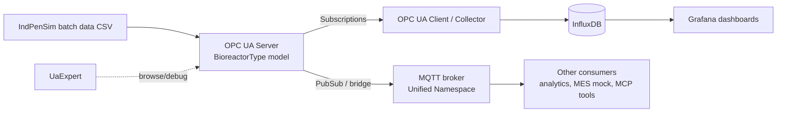

# OPC UA Bioprocess Lab

A hands-on learning project for **OPC UA** and the industrial data standards around it, built on a simulated penicillin fermentation process (IndPenSim). It goes from a bare OPC UA server to a modelled, secured, GxP-aware bioprocess data stack.

> **Status:** 🟡 Planned. See the [Progress](#progress) checklist.
> **Cost:** €0. Every tool below is free or open source.

---

## Why this project

Life-science manufacturing is moving away from siloed equipment and paper records towards connected, model-driven plants: Pharma 4.0, modular "plug and produce" skids, and unified data for MES and analytics. OPC UA is the backbone standard for that shift. This repo is a learning record. It builds each concept on realistic bioprocess data, not toy counters, and documents what was learned at each step.

## Learning goals

By the end I want to be able to explain, and show working code for:

- How OPC UA structures data (address space, nodes, NodeIds, references, types)
- Client/server communication: browse, read, write, method calls, subscriptions
- Information modelling: custom ObjectTypes, NodeSet2 XML, companion specifications
- OPC UA security: certificates, security policies, user authentication
- How OPC UA fits with ISA-95, ISA-88, MQTT/Sparkplug B, Unified Namespace, and MTP
- How data integrity principles (ALCOA+, audit trails) apply to equipment data in GxP environments

## Target architecture



## Tech stack (all free)

| Purpose | Tool |
|---|---|
| OPC UA server/client (Python) | [`asyncua`](https://github.com/FreeOpcUa/opcua-asyncio) |
| Debug / browse client | UaExpert (Unified Automation, free download) |
| Reference simulation server | Prosys OPC UA Simulation Server (free) or Microsoft `opc-plc` Docker image |
| Simulated process data | IndPenSim penicillin fermentation dataset |
| Time-series store | InfluxDB OSS |
| Dashboards | Grafana OSS |
| Message broker | Eclipse Mosquitto |
| Low-code flows (optional) | Node-RED with OPC UA nodes |
| Containers | Docker / Docker Compose |
| Info model compiler | OPC Foundation UA-ModelCompiler (open source) |

---

## Roadmap

Each phase ends with a working deliverable and a short write-up in `docs/`. The write-ups double as LinkedIn post material.

### Phase 0: Fundamentals and setup
**Learn:** what OPC UA is and why it replaced OPC Classic; client/server vs PubSub; the address space.
**Do:**
- Install UaExpert and the Prosys Simulation Server
- Connect, browse the tree, add variables to the Data Access view, write a value, watch a subscription update
- Note the difference between polling a value and subscribing to it

**Done when:** I can explain nodes, NodeIds, namespaces and subscriptions in my own words (`docs/00-fundamentals.md`).

### Phase 1: First server, a static bioreactor
**Learn:** creating objects, variables, writable nodes and methods in `asyncua`.
**Do:**
- Build `server/basic_server.py` exposing `Bioreactor1` with Temperature, pH, DO, Agitation, Volume
- Add a `StartBatch()` / `StopBatch()` method
- Write `client/read_write.py` to read, write and call methods

**Done when:** UaExpert shows the reactor tree and the client script round-trips values.

### Phase 2: IndPenSim replay server
**Learn:** how real process data maps onto an OPC UA model; timestamps (source vs server); status codes (Good/Bad/Uncertain).
**Do:**
- Stream an IndPenSim batch through the server at configurable speed (e.g. 60× real time)
- Set correct `SourceTimestamp` and `StatusCode` on every value
- Add engineering units (`EUInformation`) and ranges (`EURange`)

**Done when:** a full batch replays live and is visible in UaExpert with units.
**Share:** "Replaying a penicillin fermentation over OPC UA" with a GIF.

### Phase 3: Collecting and visualising
**Learn:** subscriptions, monitored items, sampling vs publishing intervals, deadbands.
**Do:**
- `client/collector.py` subscribes to all process variables and writes to InfluxDB
- Docker Compose stack: server + collector + InfluxDB + Grafana
- Grafana dashboard: batch trends, current phase, alarms

**Done when:** `docker compose up` gives a live bioprocess dashboard.

### Phase 4: Information modelling
**Learn:** ObjectTypes vs instances, HasComponent and HasProperty references, NodeSet2 XML, companion specifications.
**Do:**
- Define a `BioreactorType` ObjectType and instantiate several reactors from it
- Export or author the model as NodeSet2 XML; load it into the server
- Model batch phases with an ISA-88-style state machine (Idle → Running → Held → Complete)
- Read through relevant companion specs and note how they model things:
  - **LADS** (Laboratory and Analytical Device Standard): lab devices
  - **PA-DIM** (Process Automation Device Information Model): field instruments
  - **PackML / OPC 30050**: machine state model

**Done when:** a client can discover "all bioreactors" by type, not by hard-coded NodeIds.
**Share:** "Why information models matter more than the protocol."

### Phase 5: Security and data integrity
**Learn:** application certificates, trust lists, security modes (None / Sign / SignAndEncrypt), user auth; ALCOA+ and audit trails.
**Do:**
- Run the server with `Basic256Sha256` + SignAndEncrypt and username/password users
- Separate roles: operator (read) vs engineer (write setpoints)
- Log every write and method call with user, timestamp, old/new value (audit trail)
- Write `docs/05-gxp-data-integrity.md` mapping the features to ALCOA+ principles

**Done when:** an unauthenticated or untrusted client is rejected, and every change is traceable.

### Phase 6: Unified Namespace with MQTT
**Learn:** OPC UA PubSub, MQTT, Sparkplug B, Unified Namespace, ISA-95 equipment hierarchy.
**Do:**
- Bridge the server to Mosquitto, publishing on an ISA-95 topic structure, e.g. `site/area/line/bioreactor1/temperature`
- Compare three approaches: a custom bridge, OPC UA PubSub over MQTT (JSON), and Sparkplug B
- Document the trade-offs: when to use client/server vs PubSub vs MQTT

**Done when:** a second consumer gets live data from the broker without touching the OPC UA server.
**Share:** "OPC UA vs MQTT is the wrong question."

### Phase 7: Modular plant concepts (stretch)
**Learn:** **MTP** (Module Type Package, VDI/VDE/NAMUR 2658), which describes a skid's interface and services so a process orchestration layer can plug it in.
**Do:**
- Expose the bioreactor as a "module" offering services (Fermentation, CIP) with a standard state machine
- Write a tiny orchestrator that sequences services across two simulated modules

**Done when:** the orchestrator runs a batch by calling services, not by poking tags.

### Phase 8: AI tool integration (stretch)
**Do:** point my bioprocess MCP server at the live OPC UA endpoint instead of static CSVs, so an LLM can query current batch state.
**Share:** "Letting an LLM read a live bioreactor safely" (read-only, scoped tools).

---

## Planned repo structure

```
opcua-bioprocess-lab/
├── server/            # OPC UA servers (basic, replay, modelled, secure)
├── client/            # read/write, collector, orchestrator
├── models/            # NodeSet2 XML information models
├── bridge/            # MQTT / UNS bridge
├── data/              # IndPenSim sample batches (or download script)
├── docker/            # compose files, Grafana dashboards
├── docs/              # one write-up per phase
└── README.md
```

## Standards cheat sheet

| Standard | What it is | Where it shows up here |
|---|---|---|
| OPC UA (IEC 62541) | Secure, model-based industrial communication | Everything |
| OPC UA PubSub | Publish/subscribe transport for OPC UA | Phase 6 |
| ISA-95 | Enterprise/control integration and equipment hierarchy | Topic structure, Phase 6 |
| ISA-88 | Batch control models and states | State machine, Phase 4 |
| PackML | Standard machine state model | Phase 4 reading |
| LADS | OPC UA companion spec for lab and analytical devices | Phase 4 reading |
| PA-DIM | Companion spec for process instruments | Phase 4 reading |
| MTP (VDI 2658) | Modular plant / skid integration | Phase 7 |
| MQTT / Sparkplug B | Lightweight pub/sub messaging and payload spec | Phase 6 |
| ALCOA+ / 21 CFR Part 11 / EU GMP Annex 11 | Data integrity and electronic records in regulated manufacturing | Phase 5 |

## Learning resources (free)

- OPC Foundation: specifications (free account) and "OPC UA Online Reference"
- `asyncua` examples folder on GitHub
- Unified Automation: UaExpert documentation
- IndPenSim dataset and paper (Goldrick et al.)
- HiveMQ blog: MQTT and Sparkplug essentials series
- NAMUR / ZVEI: MTP overview white papers

## Progress

- [ ] Phase 0: Fundamentals and setup
- [ ] Phase 1: First server
- [ ] Phase 2: IndPenSim replay
- [ ] Phase 3: Collecting and visualising
- [ ] Phase 4: Information modelling
- [ ] Phase 5: Security and data integrity
- [ ] Phase 6: Unified Namespace / MQTT
- [ ] Phase 7: Modular plant (stretch)
- [ ] Phase 8: AI tool integration (stretch)

## Disclaimer

Personal learning project using public, simulated data. Not affiliated with any employer or vendor, and not validated for GxP use.
